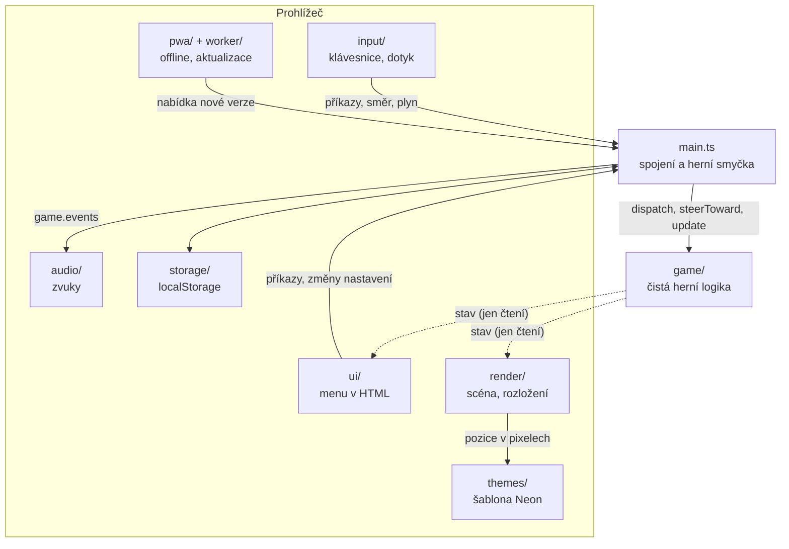
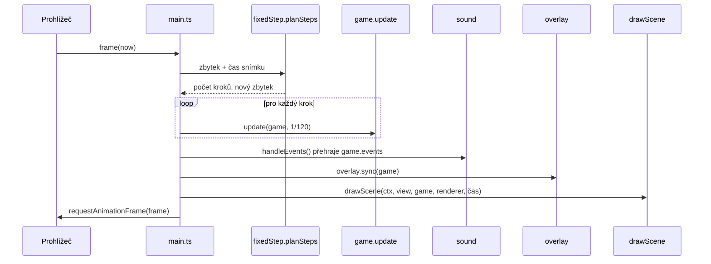
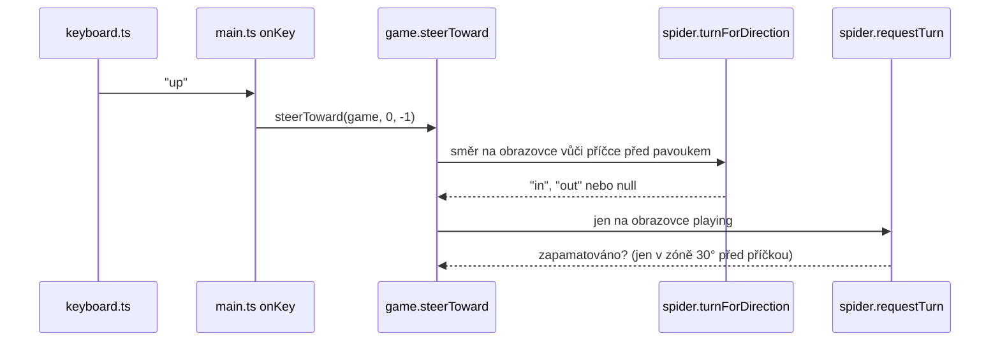
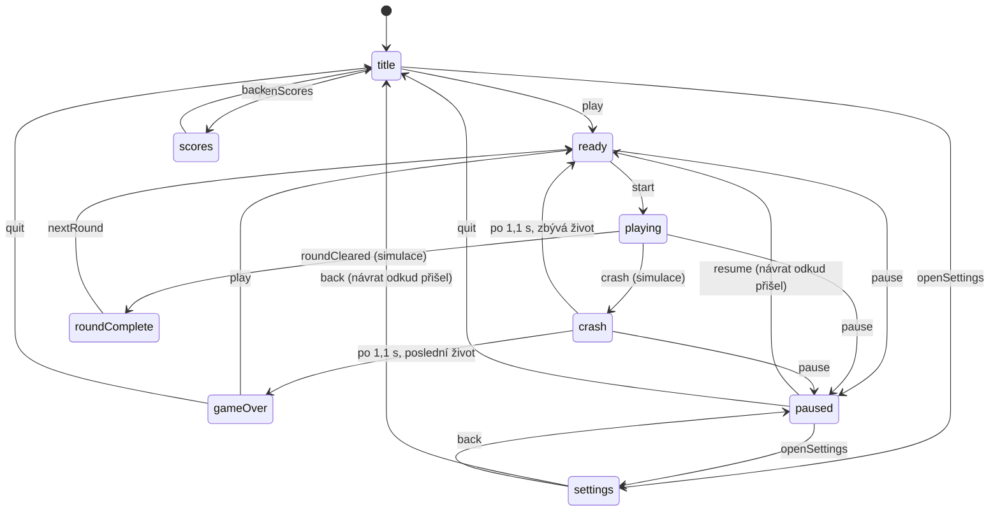
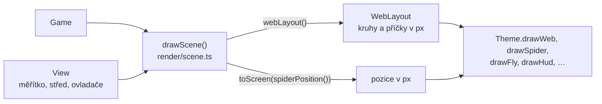
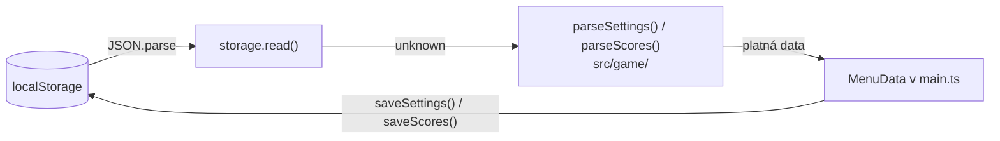

# Architektura a provázání

[← Programátorská dokumentace](README.md)

Tahle stránka popisuje, jak spolu části hry mluví. Podrobnosti o jednotlivých modulech jsou v [herni-logika.md](herni-logika.md) a [prohlizecova-vrstva.md](prohlizecova-vrstva.md).

## Vrstvy



Pravidla, která drží strukturu pohromadě:

1. **`src/game/` nezávisí na ničem jiném.** Neimportuje nic mimo svou složku a nepoužívá DOM, Canvas, `window`, `Date.now()` ani `Math.random()`. Proto jde celá hra simulovat v unit testu.
2. **Vykreslování a menu stav jen čtou.** `render/` a `ui/` dostanou objekt `Game`, ale nic v něm nemění. Co si potřebují pamatovat (fáze nohou, zobrazená obrazovka), drží ve vlastních strukturách.
3. **Šablona nevidí stav hry.** `themes/` dostává hotové pozice v pixelech, velikosti a role (`player`, `enemy`, `slowedEnemy`). Nová šablona tak nemůže rozbít pravidla.
4. **`main.ts` je jediné místo, které zná všechny vrstvy.** Vytvoří hru, napojí vstup, menu, zvuk a úložiště a řídí smyčku.

Typy smějí téct opačným směrem: `themes/theme.ts` importuje typ `View` z `render/` a typy balíčků z `game/`. Jde jen o typy, za běhu závislost nevzniká.

## Stav hry

Celý stav je jeden objekt `Game` z `src/game/game.ts`:

```
Game
├── screen      aktuální obrazovka (title, ready, playing, crash, paused, …)
├── session     jedna hra od „Hrát“ po „Konec hry“: obtížnost, kolo, životy, skóre
├── field       hrací pole aktuálního kola
│   ├── ringCount, level
│   ├── player          Spider
│   ├── enemies         Spider[]
│   ├── flies           Fly[]
│   └── bonus           BonusState (balíček, zpomalení, zpráva)
├── throttle    drží hráč plyn? (nastavuje vstup)
├── difficulty  zvolená obtížnost pro příští hru (nastavuje menu)
├── random      generátor se semínkem, jediný zdroj náhody
└── events      co se stalo od posledního vyprázdnění (pro zvuky)
```

Stav je obyčejný měnitelný objekt. Logika ho upravuje na místě, protože při 120 krocích za sekundu by kopírování nic nepřineslo. Výjimkou jsou obrazovky: `transition()` vrací nový objekt, a když se nic nemění, vrátí ten stejný. Volající tak pozná změnu porovnáním identity.

## Herní smyčka

`src/main.ts` volá `frame()` přes `requestAnimationFrame`. Každý snímek:



- **Pevný krok.** `planSteps()` přičte čas snímku ke zbytku z minula a rozdělí ho na celé kroky po `FIXED_STEP` (1/120 s). Na 60 Hz displeji jsou to dva kroky na snímek, na 144 Hz většinou jeden a občas žádný. Výsledek simulace tak nezávisí na displeji.
- **Strop.** Čas snímku je omezený na `MAX_FRAME_TIME` (0,25 s). Po návratu do záložky na pozadí se hra nesnaží dohnat stovky kroků najednou.
- **Události jednou za snímek.** Krok simulace jen přidává do `game.events`. `handleEvents()` je po všech krocích přehraje (stejná událost vícekrát za snímek zazní jednou) a seznam vyprázdní. Událost `gameOver` zároveň zapíše hru do tabulky výsledků.
- **Menu po simulaci.** Obrazovka se může změnit i sama (havárie po 1,1 s přejde na „Připraven“ nebo „Konec hry“), proto `overlay.sync()` běží každý snímek. Panel přestaví, jen když se změnil název obrazovky.

## Tok vstupu

Vstup do logiky nikdy nevolá `update()`. Má tři cesty:

| Cesta | Funkce v `game.ts` | Kdo ji volá |
| --- | --- | --- |
| Příkaz obrazovce (`play`, `start`, `pause`, `resume`, `quit`, `back`, `nextRound`, …) | `dispatch(game, command)` | Tlačítka menu, Enter a Esc přes `confirmEvent()` a `cancelEvent()`, klepnutí na touchpad, ztráta fokusu. |
| Přelezení na jiný kruh | `steerToward(game, dx, dy)` | Šipky a WASD jako směr na obrazovce, tahy po touchpadu. |
| Plyn | přímý zápis `game.throttle` | Mezerník, Shift nebo levý palec. Klávesnice a dotyk se sčítají (`throttle.keys || throttle.touch`). |

Příklad: hráč stiskne šipku nahoru, když pavouk leze po pravé straně pavučiny.



Samotné přelezení pak proběhne v některém z dalších kroků `update()`, až pavouk dojde na příčku.

## Jeden krok simulace

`update(game, dt)` v `src/game/game.ts`:

1. Na obrazovce `playing` zavolá `playStep()`:
   1. `stepField()` posune hráče (s plynem rychleji) a nepřátele (při zpomalení pomaleji). Nepřítel, který právě dojde na příčku, se rozhodne přes `chooseEnemyTurn()`.
   2. Nové přelezení přidá událost `climb`.
   3. `collectFlies()` sebere mouchy pod hráčem, `addPoints()` přičte body a případný život navíc.
   4. `updateBonus()` odpočítá čekání na balíček, vytvoří ho, nechá zmizet, nebo vrátí snědený druh. `applyBonus()` přičte body nebo život.
   5. Když nezbývá moucha, `finishRound()` přičte bonus za kolo a přejde na `roundComplete`. Poslední moucha má přednost před srážkou ve stejném kroku.
   6. Jinak `playerHitsEnemy()` zkontroluje srážku a `crash()` ubere život.
2. `tickScreen()` odpočítá animaci havárie. Po jejím konci přejde na `ready` (nové pole stejného kola) nebo `gameOver` (událost `gameOver`).

## Obrazovky



Přechody `crash` a `roundCleared` nemůže poslat hráč, typ `Command` (`PlayerEvent`) je vylučuje. Vznikají jen v simulaci.

`applyEvent()` v `game.ts` k přechodu přidá vedlejší účinky: `play` založí novou `Session` podle zvolené obtížnosti, `nextRound` zvýší číslo kola a obě vytvoří nové hrací pole.

## Vykreslení snímku



- `createView()` se volá při změně velikosti okna. Spočítá, kolik pixelů je jednotka R (polovina strany hrací plochy), kde je střed a kde dotykové ovladače, vše uvnitř bezpečné oblasti displeje.
- `drawScene()` rozhoduje, co je vidět a kde. Velikosti much, balíčků a pavouků jsou v jednotkách R, takže odpovídají vzdálenostem pro srážky.
- Šablona dostane jen pixely a rozhodne, jak věci vypadají.

## Menu a nastavení

`createOverlay()` dostane funkci, která vrací aktuální `MenuData` (nastavení, výsledky, poslední umístění, seznam šablon, nabídku aktualizace), a dvě obsluhy: `command` (příkaz obrazovce) a `settings` (změna nastavení).

Změna nastavení v `main.ts` (`changeSettings()`) nastavení uloží, zapne nebo vypne zvuk, přepíše `game.difficulty` a případně přepne šablonu. Obtížnost se projeví až při příštím „Hrát“, protože `createSession()` ji čte jen tehdy.

## Ukládání



Kontrola uložených dat je v čisté logice (`settings.ts`, `scores.ts`), takže má unit testy. `storage.ts` jen čte a zapisuje a každou chybu (soukromé okno, plné úložiště) tiše spolkne.

## Offline a aktualizace

1. Při buildu `pwaPlugin()` ve `vite.config.ts` vloží do `sw.js` seznam souborů a otisk verze.
2. Při první návštěvě `registerServiceWorker()` zaregistruje `sw.js`, ten uloží všechny soubory do mezipaměti a převezme stránku.
3. Při další návštěvě s novým buildem se nová verze nainstaluje, ale čeká. `registerServiceWorker()` zavolá obsluhu v `main.ts`, ta uloží funkci do `menu.update` a úvodní obrazovka ukáže „Je dostupná nová verze“.
4. Tlačítko Aktualizovat pošle čekajícímu workeru `skipWaiting`, ten převezme stránku a ta se znovu načte.

Podrobnosti v [prohlizecova-vrstva.md](prohlizecova-vrstva.md#pwa-a-service-worker).

## Ladicí režim

S `?debug` v adrese:

- `window.spiderOn` je objekt `Game`, `window.spiderOnView` aktuální `View`. Čtou je E2E testy a konzole.
- `?debug&seed=123` spustí hru s pevným semínkem, takže se dá přesně zopakovat.
- Klávesa K simuluje srážku, C sní všechny mouchy (dokončí kolo).

## Jak přidat…

**Nové pravidlo nebo číslo.** Uprav `docs/specifikace.md`, konstantu dej do `config.ts`, logiku do příslušného modulu v `src/game/` a test vedle. Vykreslování se obvykle měnit nemusí.

**Novou šablonu vzhledu.** Vytvoř `src/themes/<id>/` s objektem typu `Theme` a přidej ho do pole `THEMES` v `main.ts`. Nastavení ji samo nabídne, `parseSettings()` přijme její `id`.

**Novou obrazovku.** Přidej typ do `Screen` a události do `ScreenEvent` v `screens.ts`, přechody do `transition()`, chování kláves do `confirmEvent()` a `cancelEvent()` (TypeScript ohlásí chybějící větev `switch`) a panel do `panelFor()` v `ui/overlay.ts`.

**Nový zvuk.** Přidej název do `GameEvent` v `game.ts`, přidávej ho do `game.events` v logice a popiš tóny v `SOUNDS` v `audio/sound.ts`. Typ `Record<GameEvent, …>` nedovolí na zvuk zapomenout.

**Nový soubor v `public/`.** Přidej ho do `PUBLIC_FILES` ve `vite.config.ts`, jinak nebude offline.
