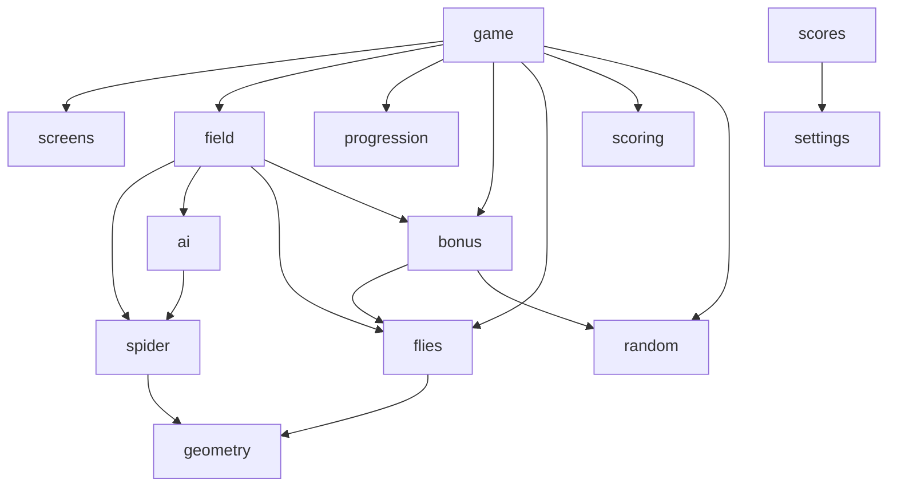

# Herní logika (`src/game/`)

[← Programátorská dokumentace](README.md)

Herní logika je čistý TypeScript bez prohlížeče. Rozhoduje o všem, co se ve hře stane: kam pavouci lezou, co hráč sebere, kdy narazí a jaká obrazovka následuje. Každý modul má vedle sebe unit testy (`*.test.ts`). Pravidla, ze kterých kód vychází, jsou ve [specifikaci](../specifikace.md), na jejíž kapitoly odkazují komentáře v kódu.

## Jednotky a souřadnice

- **Vzdálenost** se měří v jednotkách **R**, což je polovina strany čtvercové hrací plochy. Střed pavučiny je v bodě (0, 0), vnější kruh má poloměr 0,92 R. Převod na pixely dělá až `render/`.
- **Úhel** je v radiánech v rozsahu [0, 2π). 0 míří doprava a úhel roste **po směru hodinových ručiček**, protože osa y na obrazovce míří dolů. Úhel 90° (π/2) je tedy dole.
- **Čas** je v sekundách a přichází jako parametr `dt`. Hlavní smyčka ho posílá vždy jako `FIXED_STEP` = 1/120 s.
- **Náhoda** je funkce `Random` (vrací číslo v [0, 1)) vytvořená ze semínka. Stejné semínko dá stejnou hru.

Pavučina má 12 paprsků (`SPOKE_COUNT`) po 30°. Čtyři z nich jsou **příčky** (`GATE_SPOKES` = 0, 3, 6, 9: vpravo, dole, vlevo, nahoře), jen po nich se dá přelézt na sousední kruh. Kruhy se číslují od 0 (vnitřní) po `ringCount - 1` (vnější).

## Přehled modulů

| Modul | Odpovědnost | Hlavní exporty |
| --- | --- | --- |
| `config.ts` | Laditelné konstanty | `FIXED_STEP`, `PLAYER_SPEED`, `START_ROUND`, … |
| `game.ts` | Stav celé hry a jeho změny | `createGame`, `dispatch`, `steerToward`, `update`, `crash` |
| `screens.ts` | Obrazovky a přechody | `transition`, `tickScreen`, `confirmEvent`, `cancelEvent` |
| `field.ts` | Hrací pole jednoho kola | `createField`, `stepField`, `steerPlayer`, `playerHitsEnemy` |
| `spider.ts` | Pohyb jednoho pavouka | `createSpider`, `stepSpider`, `requestTurn`, `spiderPosition`, `turnForDirection` |
| `ai.ts` | Rozhodnutí nepřítele na příčce | `chooseEnemyTurn`, `turnChance`, `playerTargetRing` |
| `flies.ts` | Mouchy | `createFlies`, `collectFlies`, `fliesLeft` |
| `bonus.ts` | Bonusové balíčky a zpomalení | `createBonusState`, `updateBonus`, `spawnPackage` |
| `progression.ts` | Obtížnost podle kola | `ringCountForRound`, `difficultyForRound`, `enemiesForDifficulty`, `webGrowsAfter` |
| `scoring.ts` | Body a životy navíc | `addPoints` |
| `scores.ts` | Tabulka výsledků | `addScore`, `bestScore`, `parseScores` |
| `settings.ts` | Nastavení hráče | `parseSettings`, `cleanName`, `DIFFICULTIES` |
| `geometry.ts` | Tvar pavučiny | `ringRadius`, `ringPoint`, `normalizeAngle` |
| `fixedStep.ts` | Pevný krok simulace | `planSteps` |
| `random.ts` | Náhoda se semínkem | `createRandom`, `randomBetween`, `pickRandom` |

Závislosti mezi moduly (šipka znamená „používá“):



Všechny moduly čtou konstanty z `config.ts` (v grafu vynecháno).

---

## `game.ts`: stav hry

Vstupní bod logiky. Prohlížečová vrstva (`main.ts`) nic jiného z logiky za běhu volat nemusí.

### Typy

- **`Game`**: celý stav (popsaný v [architektura.md](architektura.md#stav-hry)).
- **`Session`**: jedna hra od „Hrát“ do „Konec hry“: `difficulty`, `round`, `lives`, `score`, `roundPoints` (body za mouchy v kole, pro obrazovku „Kolo dokončeno“) a `roundBonus`.
- **`GameEvent`**: `"fly" | "bonus" | "climb" | "crash" | "roundClear" | "gameOver"`. Okamžiky, na které reagují zvuky.
- **`Command`**: příkaz, který smí poslat hráč (`PlayerEvent` ze `screens.ts`).

### Funkce

| Funkce | Co dělá |
| --- | --- |
| `createGame(seed)` | Nová hra na úvodní obrazovce s generátorem ze semínka. Pole pro kolo 1 slouží jako pozadí menu. |
| `createSession(difficulty)` | Nová `Session`: kolo podle `START_ROUND` (lehká 1, střední 7, těžká 14), 3 životy, 0 bodů. |
| `dispatch(game, command)` | Pošle příkaz obrazovce. Vrátí `false`, když ho aktuální obrazovka ignoruje (pak se menu nepřestavuje). |
| `steer(game, turn)` | Požádá hráčova pavouka o přelezení `"in"` nebo `"out"`. Jen na obrazovce `playing`. |
| `steerToward(game, dx, dy)` | Totéž, ale ze směru na obrazovce (x doprava, y dolů). Používají ho šipky i tahy. |
| `crash(game)` | Ubere život, přidá událost `crash` a přejde na animaci havárie. Volá ho simulace a ladicí klávesa K. |
| `debugEatAllFlies(game)` | Ladicí klávesa C: označí všechny mouchy za sebrané, příští krok dokončí kolo. |
| `update(game, dt)` | Jeden krok simulace (viz níže). |

### `update(game, dt)`

```ts
export function update(game: Game, dt: number): void {
  if (game.screen.name === "playing") playStep(game, dt);
  const previous = game.screen;
  game.screen = tickScreen(game.screen, dt);
  // ... po havárii: gameOver, nebo nové pole stejného kola
}
```

`playStep()` v tomto pořadí: posune pole (`stepField`), ohlásí nové přelezení, sebere mouchy (`collectFlies` a `addPoints`), vyhodnotí balíček (`updateBonus` a `applyBonus`), a pak buď dokončí kolo, nebo zkontroluje srážku. Pořadí je záměrné: když hráč ve stejném kroku sní poslední mouchu a narazí, vyhrává moucha.

Bonus za kolo je `ROUND_BONUS_PER_ROUND × číslo kola` (100 × kolo).

### Vedlejší účinky přechodů

`applyEvent()` (soukromá) zavolá `transition()` a podle události:

- `play`: nová `Session` podle `game.difficulty`,
- `nextRound`: `session.round += 1`,
- `play` i `nextRound`: vynuluje `roundPoints` a vytvoří nové pole pro aktuální kolo.

Po havárii s životem v záloze vytvoří `update()` nové pole stejného kola. Mouchy se vrátí všechny (spec kapitola 8).

### Použití

```ts
const game = createGame(42);
dispatch(game, { type: "play" });   // title → ready
dispatch(game, { type: "start" });  // ready → playing
for (let i = 0; i < 120; i++) update(game, FIXED_STEP); // jedna sekunda hry
console.log(game.session.score, game.events);
```

Takhle vypadá většina testů v `game.test.ts`.

---

## `screens.ts`: obrazovky

Každá obrazovka je obyčejná hodnota s polem `name`. Některé nesou data navíc:

| Obrazovka | Data | Význam |
| --- | --- | --- |
| `title` | | Úvodní menu. |
| `scores` | | Tabulka výsledků. |
| `help` | | Jak hrát: cíl hry a ovládání. |
| `settings` | `back` | Nastavení, `back` je obrazovka, kam se vrátit (úvod nebo pauza). |
| `ready` | | Pavučina je vidět, čeká se na spuštění kola. |
| `playing` | | Kolo běží. |
| `crash` | `timeLeft`, `lastLife` | Animace havárie, `CRASH_DURATION` = 1,1 s. |
| `paused` | `resume` | Pauza, `resume` je obrazovka, kam se vrátit. |
| `roundComplete` | | Kolo dokončeno. |
| `gameOver` | | Konec hry. |

| Funkce | Co dělá |
| --- | --- |
| `transition(screen, event)` | Vrátí další obrazovku. Událost, která na obrazovce nedává smysl, vrátí **tentýž objekt**, takže stačí porovnat `next === screen`. |
| `tickScreen(screen, dt)` | Odpočítá čas. Sama se mění jen havárie: po vypršení přejde na `ready`, nebo na `gameOver`, když šlo o poslední život. |
| `confirmEvent(screen)` | Událost pro Enter, mezerník nebo klepnutí (`play`, `start`, `resume`, `nextRound`), nebo `null`. |
| `cancelEvent(screen)` | Událost pro Esc nebo P (`pause`, `resume`, `back`), nebo `null`. |

`confirmEvent` a `cancelEvent` mají `switch` přes všechny obrazovky bez větve `default`. Když přibude obrazovka, TypeScript ohlásí, že jí chybí chování kláves.

Časovače (`tickScreen` a přelezení ve `spider.ts`) porovnávají s tolerancí `1e-9`. Důvod: 1,1 s není v plovoucí čárce přesně 132 × 1/120, bez tolerance by animace trvala o krok déle.

---

## `field.ts`: hrací pole kola

```ts
type Field = {
  ringCount: number;   // 3 až 5
  level: number;       // úroveň obtížnosti, určuje chování nepřátel
  player: Spider;
  enemies: Spider[];
  flies: Fly[];
  bonus: BonusState;
};
```

| Funkce | Co dělá |
| --- | --- |
| `createField(ringCount, enemies, level, bonus)` | Pole ve výchozím stavu. Hráč na vnějším kruhu dole (90°), leze proti směru hodinových ručiček. Nepřátelé na vnitřních kruzích naproti hráči (270°, 225°, 315°), lezou po směru. `enemies` je pole rychlostí jako násobků rychlosti hráče. |
| `steerPlayer(field, turn, throttle)` | Předá žádost o přelezení hráčovu pavoukovi. |
| `stepField(field, dt, throttle, random)` | Posune hráče (s plynem `THROTTLE_FACTOR` = 1,7×) a nepřátele (při zpomalení `SLOWDOWN_FACTOR` = 0,5×). Nepřítel se rozhoduje přesně v kroku, kdy dojde na příčku, aby reagoval na to, kam hráč míří teď. |
| `playerHitsEnemy(field)` | Srážka, když jsou středy pavouků blíž než `COLLISION_DISTANCE` (0,075 R). Platí i během přelézání. |

Pole vytváří `game.ts` přes soukromou `createRoundField(round, random)`, která z čísla kola odvodí velikost pavučiny, úroveň, nepřátele a zda jsou zapnuté balíčky.

---

## `spider.ts`: pohyb pavouka

Hráč i nepřátelé používají stejný kód. Liší se jen směrem, rychlostí a tím, kdo rozhoduje o přelezení.

```ts
type Spider = {
  ring: number;              // aktuální kruh; při přelézání ten, který opouští
  angle: number;             // úhel; při přelézání úhel příčky
  direction: 1 | -1;         // 1 po směru hodinových ručiček
  speed: number;             // základní rychlost v R za sekundu
  pending: Turn | null;      // zapamatované přelezení před příčkou
  crossing: Crossing | null; // právě probíhající přelézání
};
```

### Jak funguje přelezení

1. Hráč požádá o přelezení (`requestTurn`). Žádost se přijme jen v **zóně 30° před příčkou** (`TURN_ZONE`) a jen když cílový kruh existuje. Uloží se do `pending`, pozdější žádost přepíše dřívější.
2. Když pavouk v kroku `stepSpider` dojde na příčku a má `pending`, zastaví se přesně na ní (zbytek kroku zahodí) a začne `crossing`.
3. Přelézání trvá `CROSSING_TIME` (0,3 s). Během něj se poloha lineárně posouvá po příčce mezi poloměry kruhů.
4. Zopakuje-li hráč během přelézání stejný směr (bez plynu), nastaví se `continues` a pavouk po dolezení pokračuje o další kruh.

| Funkce | Co dělá |
| --- | --- |
| `createSpider(ring, angle, direction, speed)` | Nový pavouk. |
| `requestTurn(spider, turn, ringCount, throttle)` | Žádost o přelezení podle pravidel výše. Vrátí, zda byla přijata. |
| `stepSpider(spider, dt, ringCount, speedFactor)` | Posun o `dt`. Rychlost podél kruhu je stálá, takže úhlová rychlost je na vnitřních kruzích vyšší. |
| `reachesGate(spider, dt, ringCount, speedFactor)` | Dojde pavouk v tomto kroku na příčku? Používá AI nepřátel. |
| `distanceToGate(spider)` | Úhel do další příčky ve směru pohybu, v rozsahu (0, 90°]. Pavouk stojící přesně na příčce ji právě opustil. |
| `spiderPosition(spider, ringCount)` | Poloha středu v jednotkách R, i během přelézání. |
| `headingGateAngle(spider)` | Úhel příčky, ke které pavouk míří (nebo po které leze). |
| `turnForDirection(spider, dx, dy)` | Převede směr na obrazovce na `"out"` (od středu podél příčky), `"in"` (ke středu), nebo `null` (napříč, víc než 45° od příčky). |

`turnForDirection` je důvod, proč šipky fungují intuitivně: šipka nahoru u horní příčky znamená ven, u dolní příčky dovnitř.

---

## `ai.ts`: nepřátelé

Nepřátelé neplánují. Na každé příčce se rozhodnou jen mezi „přelézt o kruh směrem k hráči“ a „lézt dál“. Nebezpečí vzniká z protisměru, ne z chytrosti.

| Funkce | Co dělá |
| --- | --- |
| `turnChance(level)` | Pravděpodobnost přelezení: 0,6 na úrovni 1, +0,05 za úroveň, nejvýš 0,95. |
| `playerTargetRing(player)` | Kruh, na který hráč míří: konec přelézání (případně o kruh dál), kruh zapamatovaného přelezení, jinak aktuální kruh. |
| `chooseEnemyTurn(enemy, player, level, random)` | `"in"`, `"out"` nebo `null`. Náhodné číslo losuje jen tehdy, když je co rozhodovat, aby posloupnost náhody nezávisela na tom, jak často jsou na stejném kruhu. |

---

## `flies.ts`: mouchy

Na každém kruhu je 12 much uprostřed mezi paprsky (15°, 45°, …).

| Funkce | Co dělá |
| --- | --- |
| `createFlies(ringCount)` | Všechny mouchy pro pavučinu. |
| `collectFlies(flies, player)` | Sebere mouchy na hráčově kruhu blíž než `FLY_PICKUP_ANGLE` (0,06 rad). Vrátí počet. Během přelézání nic. |
| `fliesLeft(flies)` | Kolik much zbývá. Nula znamená konec kola. |

Okno pro sebrání (0,12 rad) je širší než nejdelší krok hráče (asi 0,035 rad s plynem na vnitřním kruhu), takže moucha nemůže proklouznout mezi kroky. Komentář v kódu to dokládá výpočtem.

Body za mouchu: `FLY_POINTS` = 10.

---

## `bonus.ts`: balíčky

Od kola 4 (`BONUS_FIRST_ROUND`) se po náhodné době 5 až 20 s jedna moucha na vzdálené polovině pavučiny (90° a víc od hráče) promění v balíček. Poslední moucha se nikdy nepromění, kolo musí skončit jejím snědením.

| Druh | Šance | Účinek |
| --- | --- | --- |
| `points` | 75 % | +250 bodů |
| `slowdown` | 22 % | Nepřátelé na polovinu, dokud hráč neoběhne celé kolo (2π). |
| `life` | 3 % | +1 život (nejvýš 5). Při plných životech zpráva „Životy jsou plné“. |

```ts
type BonusState = {
  enabled: boolean;           // balíčky až od kola 4
  wait: number;               // sekundy do dalšího balíčku
  package: BonusPackage | null;
  slowdownLeft: number;       // úhel, který hráč ještě musí ulézt; 0 = bez zpomalení
  notice: BonusNotice | null; // zpráva uprostřed pavučiny
};
```

| Funkce | Co dělá |
| --- | --- |
| `createBonusState(enabled, random)` | Výchozí stav s náhodným čekáním. |
| `updateBonus(state, flies, player, angleBefore, dt, random)` | Volá se po pohybu hráče. Odpočítá zprávu, zkrátí zpomalení o ulezený úhel, zjistí snědení balíčku nebo jeho propásnutí (hráč ho minul na jiném kruhu), případně vytvoří nový. Vrátí snědený druh, nebo `null`. Zpomalení zapne sám, body a životy nechá na `game.ts`, které patří skóre. |
| `spawnPackage(flies, player, random)` | Promění náhodnou vzdálenou mouchu v balíček. |
| `rollBonusKind(random)` | Vylosuje druh podle šancí. |

---

## `progression.ts`: obtížnost

Číslo kola určuje velikost pavučiny a úroveň obtížnosti, úroveň určuje nepřátele.

| Kola | Kruhy | Úroveň |
| --- | --- | --- |
| 1 až 3 | 3 | 1 až 3 |
| 4 až 9 | 4 | 3 až 8 |
| 10 a dál | 5 | 5 a dál |

Každá větší pavučina začíná o kousek snáz, než skončila předchozí.

| Funkce | Co dělá |
| --- | --- |
| `ringCountForRound(round)` | Počet kruhů. |
| `difficultyForRound(round)` | Úroveň obtížnosti. |
| `enemiesForDifficulty(level)` | Rychlosti nepřátel podle tabulky `ENEMY_TABLE` (úrovně 1 až 9, nad ní tři rychlí). Pomalý má 0,2× rychlosti hráče, rychlý začíná na 0,4× a s každou úrovní přidá 0,02×, nejvýš 0,8×. |
| `fastEnemyFactor(level)` | Rychlost rychlého nepřítele na dané úrovni. |
| `webGrowsAfter(round)` | Bude příští kolo na větší pavučině? Menu pak hráče upozorní. |

Tabulka nepřátel je v kódu zapsaná jako tabulka, stejně jako ve specifikaci, aby šla porovnat očima.

---

## `scoring.ts`: body a životy

`addPoints(state, points)` přičte body a k tomu životy za každou překročenou hranici 5 000, 15 000, 25 000, … (nejvýš `MAX_LIVES` = 5). Všechny body ve hře jdou přes tuto funkci, takže život navíc nejde minout.

---

## `scores.ts`: tabulka výsledků

```ts
type ScoreEntry = { name: string; score: number; difficulty: Difficulty; round: number; date: string /* YYYY-MM-DD */ };
```

| Funkce | Co dělá |
| --- | --- |
| `addScore(table, entry)` | Vloží hru do tabulky (nejvýš 10 řádků). Vrátí novou tabulku a umístění od 1, nebo `null`. Nulové skóre se nezapisuje, při stejném skóre zůstane starší hra výš. Vstupní tabulku nemění. |
| `bestScore(table)` | Nejlepší skóre, nebo `null`. |
| `parseScores(data)` | Přečte uloženou tabulku jako `unknown`. Vadné řádky zahodí, řádkům ze starší verze bez obtížnosti doplní `"easy"` a znovu seřadí. |

## `settings.ts`: nastavení

```ts
type Settings = { name: string; themeId: string; sound: boolean; difficulty: "easy" | "medium" | "hard" };
```

| Funkce | Co dělá |
| --- | --- |
| `cleanName(input)` | Ořízne mezery a zkrátí na 16 znaků (počítá písmena, ne poloviny UTF-16, takže nerozpůlí emoji). Prázdné jméno vrátí `null`. |
| `parseSettings(data, themeIds)` | Přečte uložená nastavení. Každá chybějící nebo vadná hodnota dostane výchozí (`DEFAULT_SETTINGS`), neznámá šablona taky. |
| `isDifficulty(value)` | Typová kontrola obtížnosti. |

Pozor na dva pojmy: **obtížnost** (`Difficulty`, volba v menu) určuje jen počáteční kolo, **úroveň obtížnosti** (`level` v `progression.ts`) plyne z čísla kola.

---

## Pomocné moduly

### `geometry.ts`

| Funkce | Co dělá |
| --- | --- |
| `normalizeAngle(angle)` | Převede úhel do [0, 2π). |
| `ringRadius(ring, ringCount)` | Poloměr kruhu. Kruhy jsou rovnoměrně mezi 0,28 R a 0,92 R, takže menší pavučina má širší mezery. |
| `ringPoint(ring, ringCount, angle)` | Bod na kruhu. Úsek mezi dvěma paprsky je kvadratická křivka prohnutá o 6 % ke středu, aby pavučina vypadala jako z vlákna, ne jako kružnice. |

### `fixedStep.ts`

`planSteps(remainder, frameTime)` vrátí `{ steps, remainder }`: kolik celých kroků po 1/120 s spustit a kolik času přenést do dalšího snímku. Čas snímku omezí na 0,25 s. Tolerance `1e-9` zajistí, že 60 Hz dá stabilně dva kroky na snímek.

### `random.ts`

| Funkce | Co dělá |
| --- | --- |
| `createRandom(seed)` | Generátor Mulberry32 (32 bitů stavu). Malý, známý a čitelný. |
| `randomBetween(random, min, max)` | Číslo v [min, max). |
| `pickRandom(random, items)` | Náhodný prvek, nebo `undefined` pro prázdné pole. |

Generátor je v `Game.random` a dostávají ho všechny funkce, které potřebují náhodu. Semínko vybírá `main.ts` (s `?debug&seed=` pevné).

---

## `config.ts`: konstanty

Všechna čísla, která jde ladit, jsou na jednom místě s komentářem o jednotkách a důvodu. Nejdůležitější skupiny:

| Skupina | Konstanty |
| --- | --- |
| Pavučina | `MIN_RING_COUNT`, `MAX_RING_COUNT`, `SPOKE_COUNT`, `GATE_SPOKES`, `INNER_RING_RADIUS`, `OUTER_RING_RADIUS`, `SEGMENT_SAG` |
| Čas | `FIXED_STEP`, `MAX_FRAME_TIME`, `CRASH_DURATION`, `CROSSING_TIME` |
| Pohyb | `PLAYER_SPEED`, `THROTTLE_FACTOR`, `TURN_ZONE`, `ENEMY_*_FACTOR`, `ENEMY_SPEEDUP_PER_LEVEL` |
| Kolize a sbírání | `FLY_PICKUP_ANGLE`, `COLLISION_DISTANCE` |
| Body a životy | `FLY_POINTS`, `ROUND_BONUS_PER_ROUND`, `EXTRA_LIFE_FIRST`, `EXTRA_LIFE_EVERY`, `START_LIVES`, `MAX_LIVES` |
| AI | `AI_TURN_CHANCE_START`, `AI_TURN_CHANCE_STEP`, `AI_TURN_CHANCE_MAX` |
| Balíčky | `BONUS_FIRST_ROUND`, `BONUS_DELAY_MIN/MAX`, `BONUS_POINTS`, `BONUS_CHANCE_*`, `BONUS_NOTICE_TIME`, `SLOWDOWN_FACTOR` |
| Dotyk | `SWIPE_MIN_DISTANCE`, `TAP_MAX_DISTANCE`, `TAP_MAX_TIME` (čte je jen `input/gesture.ts`) |
| Výsledky a obtížnost | `SCORE_TABLE_SIZE`, `PLAYER_NAME_MAX_LENGTH`, `DEFAULT_PLAYER_NAME`, `START_ROUND` |

Testy berou čísla z konstant, ne natvrdo, takže změna hodnoty testy nerozbije, dokud platí pravidlo.
